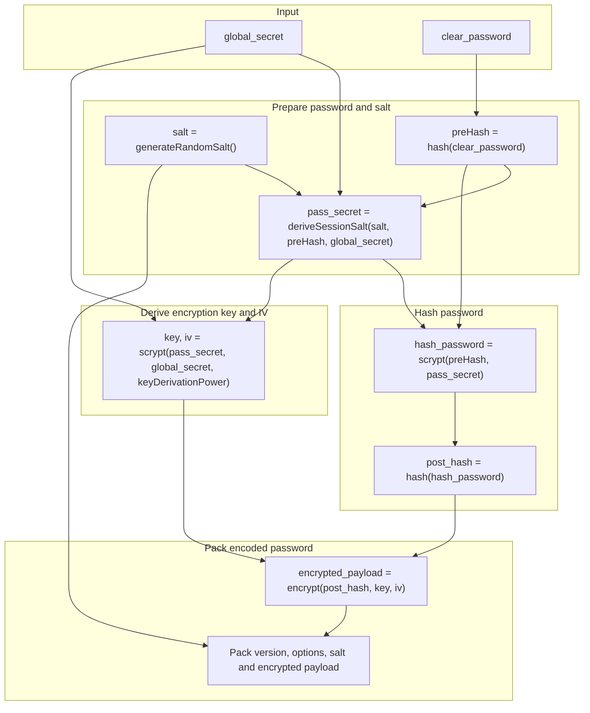

ExPass encodes passwords using scrypt, a random salt, and a shared secret
(pepper). The Node.js implementation encrypts the derived hash before packing it
into a string for storage. It does not store an encrypted copy of the original
password.

## ✨ Features

- Pre-hashing before password derivation.
- scrypt with a configurable work factor.
- A fresh random salt for each encoded password.
- A shared secret (pepper) supplied by the application.
- Symmetric encryption of the derived hash before storage.
- A packed string containing the version, salt, encoding options, and encrypted payload.
- Asynchronous password encoding and verification.
- Replaceable cryptographic components and custom backends through `@expass/core`.

## 💡 Why?

I created ExPass because I needed a way to store passwords in a database using
password hashing, salts, and a separate application secret. The goal was to bring
those steps together behind a small API for encoding and verifying passwords.

scrypt provides the password derivation step through Node.js's built-in crypto
module. The pepper adds an application secret that can be kept separate from the
database, and the packed format keeps the information needed for verification
alongside each encoded password.

## ⚖️ How ExPass compares

This table compares the Node.js implementation of ExPass with the `bcrypt` and
`argon2` npm packages and Node.js's built-in `crypto.scrypt` API. It describes what
each API provides out of the box; applications can add their own processing around
these APIs.

| Feature | ExPass (`@expass/node`) | `bcrypt` | `argon2` | Node.js `crypto.scrypt` |
| --- | --- | --- | --- | --- |
| Password derivation | scrypt | bcrypt | Argon2id by default | scrypt |
| Salt handling | Generated automatically | Generated when a numeric cost is passed to `hash` | Generated automatically unless supplied | Application supplies the salt |
| Pepper integration | Required constructor secret | Application implements it | Optional `secret` parameter | Application implements it |
| Separate pre-hash step | Included | Application implements it if needed | Application implements it if needed | Application implements it if needed |
| Encryption of the derived hash | Included (AES-CBC) | Application implements it if needed | Application implements it if needed | Application implements it if needed |
| Stored result | ExPass string with version, options, salt, and encrypted payload | bcrypt string with version, cost, salt, and hash | Encoded string with algorithm, version, parameters, salt, and hash | Derived bytes; application chooses the storage format |
| Cost controls | Password and encryption-key scrypt cost exponents | bcrypt cost factor | Memory, time, and parallelism | `N`, `r`, and `p` |

ExPass combines password derivation, pepper handling, encryption, and packaging
behind `encode` and `verify`. Using `crypto.scrypt` directly gives the application
control over how those steps are assembled. The `bcrypt` and `argon2` packages
also provide hashing and verification APIs with encoded storage formats.

### 🛡️ Additional protection beyond password hashing

ExPass combines scrypt with an application-held pepper and encryption of the
derived hash. Unlike a basic bcrypt setup without a pepper, a stolen database
alone does not contain everything needed to verify password guesses: the attacker
also needs the application's secret, provided it remains confidential and separate
from the database.

These protections are built into ExPass, so applications can use them through a
single encoding and verification API. Other implementations can also incorporate
a pepper; ExPass provides this combination out of the box.

Sources: [bcrypt API](https://github.com/kelektiv/node.bcrypt.js#usage),
[node-argon2 usage](https://github.com/ranisalt/node-argon2#usage) and
[secret parameter implementation](https://github.com/ranisalt/node-argon2/blob/master/argon2.cjs),
and [Node.js scrypt API](https://nodejs.org/api/crypto.html#cryptoscryptpassword-salt-keylen-options-callback).

## 📦 Packages

- `@expass/node`: the Node.js implementation, with `encode`, `verify`, and
  `isExPassHash` methods.
- `@expass/core`: interfaces, configuration, packaging, and dependency injection
  for implementing custom backends.

## 🧠 Why scrypt?

scrypt is a memory-hard password derivation function available through Node.js's
built-in crypto module. Its work factor makes password guessing more expensive;
its effectiveness depends on the configured cost and available resources.

[OWASP recommends Argon2id, with scrypt as an alternative when Argon2id is unavailable](https://cheatsheetseries.owasp.org/cheatsheets/Password_Storage_Cheat_Sheet.html).
Using these primitives does not by itself establish that a configuration or the
full ExPass construction meets every recommendation. Benchmark and review the
parameters for your application.

## 🔄 Encoding flow

The diagram follows the current implementation. `pass_secret` is the session salt
derived from the random salt, pre-hash, and pepper. It is used by both the password
scrypt step and the separate key/IV derivation step.

`deriveSessionSalt` uses nested HMACs, repeating and truncating the result to the
configured salt length. `power` controls the password scrypt step;
`keyDerivationPower` controls the key/IV derivation step. The algorithm choices and
non-default parameters are packed alongside the salt and encrypted payload.

Start with [Getting Started](./getting-started.md), then see
[Customization](./customization.md) and [Validation](./validation.md).
